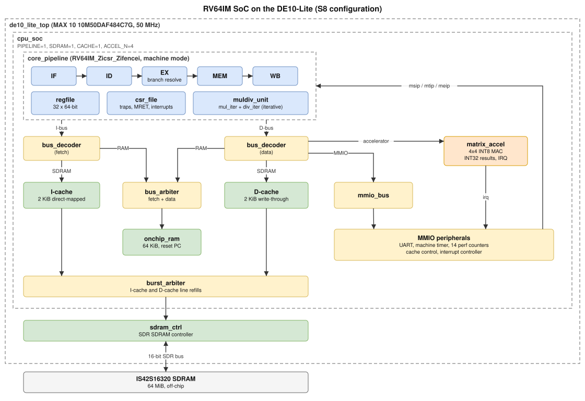

# RV64IM system on the DE10-Lite

[](https://github.com/jchik1102/riscv-soc/actions/workflows/ci.yml)

An original SystemVerilog RISC-V system for the Terasic DE10-Lite (MAX 10 `10M50DAF484C7G`) at 50 MHz. Its main core is a five-stage pipeline (IF/ID/EX/MEM/WB, with forwarding, load-use and M-unit stalls, and BHT/BTB branch prediction in fetch) implementing RV64IM_Zicsr_Zifencei in machine mode with traps, MRET and timer, software and external interrupts. The original multicycle RV64IM core is kept as a reference configuration. Around the core are an iterative multiply/divide unit, 2 KiB direct-mapped I- and D-caches over an SDR SDRAM controller for the board's 64 MiB chip, MMIO UART, timer, 16 performance counters (including resolved control transfers and mispredictions), cache control, an interrupt controller, and a 4x4 INT8 matrix multiply-accumulate accelerator with a completion interrupt. Verification never takes expected values from the RTL. A Python ISA/system model fetches and decodes every program on its own, Spike runs the same bytes, a UVM 1.2 testbench in XSim drives random and directed programs, and every checker was shown to work by injecting bugs into the RTL and the traces.



The diagram is an SVG with the draw.io model embedded; open `docs/block_diagram.svg` in draw.io to edit it.

**Demo video:** _placeholder — link to be added._

## Tools

| Tool | Version | Used for |
| --- | --- | --- |
| Quartus Prime Lite | 24.1std.0, MAX 10 device support, USB-Blaster driver | FPGA build and programming (Windows) |
| Vivado XSIM | 2025.2 with UVM 1.2 | RTL and UVM simulation (Windows) |
| WSL Ubuntu | 24.04 | firmware, Python, Spike, `make` |
| riscv64-unknown-elf-gcc | 13.2.0 | firmware |
| Python | 3.12 venv at `/home/jonat/.venvs/riscv-soc` with `requirements-lock.txt` | models, checkers, tests |
| Spike | commit in `spike-commit.txt` | reference simulator |
| PowerShell | 7 (`pwsh.exe`) for the Makefile; the scripts also run in Windows PowerShell | driving XSim and Quartus |

The scripts default to `C:\intelFPGA_lite\24.1std\quartus`, `C:\AMDDesignTools\2025.2\Vivado`, WSL distro `Ubuntu` and the venv above. Pass `-Quartus`, `-Vivado`, `-Distro` or `-LinuxPython` to override them. The Makefile uses `pwsh.exe` from `PATH`, or set `PWSH=/path/to/pwsh.exe`.

## Running it

| Command (WSL, repository root) | What it runs |
| --- | --- |
| `make models` | Python model and checker tests |
| `make test` | `scripts/regress.ps1` (everything except UVM and board builds, ends `REGRESSION_PASS`), then `scripts/regress_uvm.ps1` (UVM regression with Python/Spike re-checks, ends `UVM_REGRESSION_PASS`), then `make results` |
| `make fpga` | `scripts/build_board.ps1 -Stage s8 -Demo s8 -Power`: full Quartus compile and vectorless power estimate, then `make results` |
| `make fpga-synth` | `scripts/synthesize.ps1 -Stage s8 -Pipeline 1 -AccelN 4`: exact-device synthesis check |
| `make program` | `scripts/program_board.ps1 -Stage s8` (board connected, all switches down) |
| `make results` | `scripts/collect_results.py`: copies the logs and reports that back this README into `results/` |
| `make act` | riscv-arch-test (ACT4) RV64I and RV64M on the pipeline core, plus the same ELFs on Spike; see [Compliance and random testing](#compliance-and-random-testing) |
| `make riscvdv INSTR_CNT=300` | riscv-dv random programs on the pipeline core and Spike, each checked against the Python model |
| `make coremark` | CoreMark (10 iterations) and the S3 FIR benchmark on the pipeline core, with and without branch prediction; see [Branch prediction, CoreMark and FIR](#branch-prediction-coremark-and-fir) |
| `make formal` | SymbiYosys checks of the M unit (`formal/`); needs OSS CAD Suite with the yosys-slang plugin in WSL (the 2026-10-14 build was used, versions in [versions.txt](results/formal/versions.txt)). See [Formal checks of the M unit](#formal-checks-of-the-m-unit) |

`regress.ps1` builds the firmware itself. Run XSIM jobs one at a time; parallel XSIM runs in the same folder interfere. The same scripts can be run directly from PowerShell, for example `.\scripts\regress.ps1`.

### Continuous integration

[`.github/workflows/ci.yml`](.github/workflows/ci.yml) runs on every push and pull request, on GitHub's Ubuntu runners: the Python model and checker tests, a Verilator lint of the pipeline core, and `scripts/run-formal.sh` (the M-unit SymbiYosys checks, with the same OSS CAD Suite build as above). Everything that needs XSim or Quartus (`make test`, `act`, `riscvdv`, `coremark`, `fpga`) cannot run there and is run locally; its logs are committed under `results/`.

### On the board

1. Build the firmware images (`make test` does this too):

   ```powershell
   wsl -d Ubuntu --cd /mnt/c/projects/riscv-soc --exec /home/jonat/.venvs/riscv-soc/bin/python scripts/programs.py
   ```

2. Build the FPGA image with `make fpga`. It writes `build/quartus_board_s8_p1/output_files/de10_lite_s8_p1.sof`.
3. Connect the DE10-Lite over USB, put all switches down, and run `make program`. Programming is over JTAG and is lost at power-off. The script prints "Configuration succeeded".

The demo starts by itself; KEY0 reruns it. Switches are written SW9 ... SW0, and up = 1. LEDR0 on with LEDR1 off means the demo passed its own checks; LEDR4 = SDRAM ready, LEDR6 = caches built, LEDR7 = accelerator built, and LEDR9 blinks. SW1 SW0 select the HEX view: `0 0` shows the checksum of all results, `1 1` the accelerator case and mismatch counts, `0 1` the phase and the number of 1 ms timer interrupts taken, and `1 0` cycle counts. With `1 0`, SW5 to SW8 pick which measurement is shown (CPU or accelerator, polled or interrupt-driven, caches on or off, the 16x16 product or the 64 small cases), and SW4 SW3 SW2 show the other counters: cycles, retired instructions, memory waits, M-unit cycles, D-cache accesses and misses, uncached loads and SDRAM stores.

Earlier stage demos are built and programmed the same way with `build_board.ps1 -Stage sN -Demo <demo>` and `program_board.ps1 -Stage sN`: `-Stage s3 -Demo fir` (FIR benchmark), `-Stage s4 -Demo s4` (timer interrupts), `-Stage s5 -Demo s5` (test of all 64 MiB of SDRAM; SW9 up at KEY0 runs the hardware tester), `-Stage s6 -Demo s6` (caches) and `-Stage s7 -Demo s7` (accelerator).

## Address map

| Region | Base | Size |
| --- | --- | --- |
| On-chip RAM (reset PC) | 0x8000_0000 | 64 KiB |
| SDRAM (cacheable) | 0x9000_0000 | 64 MiB |
| UART | 0x1000_0000 | 256 B |
| Timer (MSIP, MTIMECMP, MTIME) | 0x1000_1000 | 256 B |
| Performance counters | 0x1000_2000 | 256 B |
| Cache control | 0x1000_3000 | 256 B |
| Interrupt controller | 0x1000_4000 | 256 B |
| Matrix accelerator | 0x1001_0000 | 64 KiB |

The map is defined in `config/address_map.json`; `scripts/gen_map.py` generates `rtl/soc/platform_pkg.sv` and `sw/platform.h` from it.

## Results

Every number below comes from a log in [`results/`](results/), produced by `make test`, `make fpga` and `make formal` (`results/formal/`). [`results/summary.txt`](results/summary.txt) records the commit and date, and holds the totals that `scripts/collect_results.py` derives from the logs.

**Verification**

| Check | Result | Log |
| --- | --- | --- |
| Python model and checker tests | 240 passed | [test-sim.log](results/test-sim.log) |
| Multicycle CPU traces | 131 traces, 38,447 retired instructions checked | [test-sim.log](results/test-sim.log), [trace_results.json](results/checkers/trace_results.json) |
| Pipeline CPU traces (random interrupts and resets) | 244 traces, 90,596 retired instructions checked | [test-sim.log](results/test-sim.log), [trace_results_pipeline.json](results/checkers/trace_results_pipeline.json) |
| Multicycle vs pipeline | 79 programs, 29,267 identical retirements | [core_comparison.json](results/checkers/core_comparison.json) |
| Spike comparison | 93 programs agree; 2 skipped by design (WFI is a no-op here; SDRAM instruction fetch faults here) | [summary.txt](results/summary.txt), [test-sim.log](results/test-sim.log) |
| RTL mutants | 97 of 97 detected (M unit 12, pipeline 23, SDRAM 23, cache 17, accelerator 22) | [summary.txt](results/summary.txt), [checkers/](results/checkers/) |
| Trace fault injection | 16 multicycle and 8 pipeline corruptions detected | [fault_injection.json](results/checkers/fault_injection.json) |
| SoC firmware and random whole-system runs | S4 to S8 retirements checked record by record; per-stage run and retirement totals in the summary | [summary.txt](results/summary.txt) |
| UVM 1.2 | 105 runs, 0 UVM errors; 162 transcripts (67,522 records) re-checked by Python and Spike | [summary.txt](results/summary.txt), [test-uvm.log](results/test-uvm.log) |
| UVM functional coverage (merged) | Pipeline: 100% of defined bins. Multicycle: 62.97%. The covergroups are shared, and the multicycle core cannot hit the pipeline-only bins (load-use, redirect, fetch-wait, second bus port); its trap-cause bins are also only partly hit | [pipeline](results/uvm/coverage_pipeline.txt), [multicycle](results/uvm/coverage_multicycle.txt) |

**Simulation of the board demos** ([test-sim.log](results/test-sim.log), `BOARD_TB_PASS` lines): the S3 FIR benchmark gives checksum `c6e755` in 103,387 cycles on the pipeline (109,067 before branch prediction, [baseline](results/baseline/test-sim-before-bpred.log)) and 154,346 cycles on the multicycle core, both retiring 18,009 instructions.

**FPGA build (S8, Quartus Prime Lite 24.1, `make fpga`):**

| Measurement | Result | Report |
| --- | --- | --- |
| Logic elements | 25,364 / 49,760 (51%) | [fit.summary](results/quartus/de10_lite_s8_p1.fit.summary) |
| Memory bits | 629,696 / 1,677,312 (38%) | [fit.summary](results/quartus/de10_lite_s8_p1.fit.summary) |
| 9-bit multipliers, PLLs | 16 / 288, 1 / 4 | [fit.summary](results/quartus/de10_lite_s8_p1.fit.summary) |
| Worst setup slack, 50 MHz core clock | +0.377 ns (slow 85 °C) | [sta.summary](results/quartus/de10_lite_s8_p1.sta.summary) |
| Worst hold slack, core clock | +0.158 ns (fast 0 °C) | [sta.summary](results/quartus/de10_lite_s8_p1.sta.summary) |
| Fmax, core clock | 50.96 MHz (slow 85 °C) | [sta.rpt](results/quartus/de10_lite_s8_p1.sta.rpt) |
| Power | 450.12 mW total thermal; vectorless estimate with low confidence, not a measurement | [pow.summary](results/quartus/de10_lite_s8_p1.pow.summary) |

All reported setup, hold and pulse-width checks in all three corners have positive slack.

### Compliance and random testing

**riscv-arch-test.** The current framework is ACT4, which replaced RISCOF: it builds self-checking ELFs whose expected values come from the Sail reference model (0.15) at build time, so there is no signature dump. The configuration in [`compliance/act4/riscv-soc-rv64im/`](compliance/act4/riscv-soc-rv64im/) declares I, M, Zicsr, Zifencei and Sm, trapping misaligned accesses and direct-mode `mtvec`, with privileged tests off. Each test ends by writing `tohost`, clearing `mtvec` and executing `ECALL`, which halts the core; [`scripts/act_check.py`](scripts/act_check.py) reads `tohost` from the testbench's final memory dump. The images need up to 148,256 bytes ([manifest](results/act4/manifest.json)), so these runs compile `pipe_tb` with a **256 KiB testbench memory** (`+define+TB_MEM_BYTES`); the RTL, the SoC and every other run keep the 64 KiB on-chip RAM, so these tests could not run from the board's memory. ACT4 requires GCC 15 or later, so the ELFs are built with GCC 16.1 (riscv-gnu-toolchain 2026.08.27); the firmware still uses GCC 13.2.

| Check | Result | Log |
| --- | --- | --- |
| ACT4 on the pipeline core (XSim) | RV64I 51 of 51, RV64M 13 of 13 | [rtl.log](results/act4/rtl.log), [rtl.csv](results/act4/rtl.csv) |
| Same ELFs on Spike | 64 of 64 | [spike.log](results/act4/spike.log), [spike.csv](results/act4/spike.csv) |
| ACT4 against pipeline RTL mutants | 6 of 6 detected: `sub_computes_add` 0 of 64 pass, `branch_target_off_by_four` 0 of 64, `no_mem_to_ex_forwarding` 0 of 64, `m_operand_b_takes_rs1` 51 of 64, `word_alu_not_sign_extended` 55 of 64, `load_word_zero_extended` 63 of 64 (only `I-lw-00` catches it) | [mutant logs](results/act4/), e.g. [rtl-mut_load_word_zero_extended.csv](results/act4/rtl-mut_load_word_zero_extended.csv) |

**riscv-dv.** Random programs come from riscv-dv's Python generator (pyflow) with a custom `rv64im` target ([`compliance/riscv-dv/rv64im/`](compliance/riscv-dv/rv64im/)): no C extension, misaligned accesses trap, direct-mode `mtvec`, and only the CSRs the core implements. Each program is checked twice against the independent Python model: the RTL trace by the existing pipeline checker (`scripts/check_pipeline_trace.py`), and Spike's commit log by the existing `scripts/spike_compare.py`. A program passes only if both agree with the model.

| Run | Programs | Result | Log |
| --- | --- | --- | --- |
| 300 instructions per test | 18 requested; 16 generated, 2 rejected as invalid assembly (see below) | 14 of 14 pass on the RTL and on Spike; 3,499 Spike-matched register commits | [check.log](results/riscv-dv/n300/check.log), [results.json](results/riscv-dv/n300/results.json), [gen.log](results/riscv-dv/n300/gen.log) |
| 2,000 instructions per test | 16 requested; 13 generated (`loop` and one `rand_instr` timed out in the generator), 3 rejected as invalid assembly | 10 of 10 pass on the RTL and on Spike; 6,604 Spike-matched register commits | [check.log](results/riscv-dv/n2000/check.log), [results.json](results/riscv-dv/n2000/results.json), [gen.log](results/riscv-dv/n2000/gen.log) |

**Most programs end early.** Every program that uses pyflow's load/store streams takes an unexpected load or store exception (address misaligned or access fault, causes 4 to 7) between its 93rd and 167th retired instruction, although the target declares misaligned accesses unsupported; riscv-dv's handler then dumps the registers and ends the test. The RTL, Spike and the model agree on all of it, but those programs only exercise about 100 random instructions plus the trap path. Only the arithmetic, jump-stress and loop programs, which have no load/store streams, run to their normal end: up to 2,155 retired instructions at 2,000. No program reached one of its illegal instructions before ending. The retired count and trap positions of every program are in its `check.log`.

What differs from a standard riscv-dv run, and why (all recorded in [`testlist.yaml`](compliance/riscv-dv/rv64im/testlist.yaml)):

- riscv-dv's pyflow imports `imp`, which Python 3.12 removed. [`compliance/riscv-dv/patches/0001-python312-importlib-reload.patch`](compliance/riscv-dv/patches/0001-python312-importlib-reload.patch) changes that one import to `importlib`; `scripts/riscvdv_gen.sh` applies it.
- pyflow crashes with any sub-program (`callstack_gen` is missing), so every test runs with `+num_of_sub_program=0`: there are no calls and returns between sub-programs.
- `riscv_rand_instr_test.py` overwrites its options in code and hits that crash, so `no_fence` and `illegal_instr` run through `riscv_instr_base_test` with the same options and streams.
- pyflow does not implement `riscv_hazard_instr_stream`, `riscv_multi_page_load_store_instr_stream` or `riscv_mem_region_stress_test`; they are replaced by the load/store streams it does have.
- Not run: `riscv_ebreak_test` (pyflow cannot generate EBREAK), `riscv_hint_instr_test` (pyflow emits only compressed HINTs; there is no C extension; this test was still in the list for the 300-instruction run, where it inserted none), and the debug-mode, interrupt, unaligned, PMP and CSR tests (features the core does not have).
- pyflow sometimes emits invalid assembly (`la zero, ...`); such programs are counted as not run, not as passes.
- `illegal_instr_ratio` is per 1000 main-program instructions, so the 300-instruction programs contain no illegal instructions.
- Generated programs are changed in two places by [`scripts/riscvdv_prepare.py`](scripts/riscvdv_prepare.py): `csrw mtvec, zero; ecall` is added after the `tohost` store so the core halts, and riscv-dv's fixed 5000-word user and kernel stacks are cut to 1024 words so a program fits the 64 KiB RAM.

### Formal checks of the M unit

`make formal` checks `muldiv_unit` (the iterative multiplier and divider used by both cores) against a reference written from the RISC-V spec with SystemVerilog arithmetic, using SymbiYosys with the yosys-slang frontend and Bitwuzla ([`formal/muldiv_formal.sv`](formal/muldiv_formal.sv)). Each of the 13 RV64M operations is its own task: reset, one `start`, then a bounded check up to one cycle after `done`, asserting that the result matches the reference, that `done` pulses once, and that `busy` stays high until then.

These are **bounded checks over a restricted operand space, not proofs for every input.** Each operand is built from a few free bits: bit 63, bit 31, a fill bit repeated over bits 62..32, another over bits 30..K, and K free low bits. That includes 0, ±1, small values, INT64_MIN/MAX, INT32_MIN/MAX, all-ones and division by zero. K is 8 for 11 operations and 4 for MULH and MULHSU; at K=8 MULH passed in 2,108 s and MULHSU was stopped unfinished after more than an hour ([muldiv_k8/](results/formal/muldiv_k8/)). `kill` is tied low and only one operation is started per run.

| Check | Result | Log |
| --- | --- | --- |
| All 13 operations against the spec reference | 13 of 13 pass; slowest REMU at 390 s | [summary.txt](results/formal/summary.txt), e.g. [muldiv_div](results/formal/muldiv_div/logfile.txt) |
| Covers (a full-width and a W result, DIV overflow, division by zero) | 4 of 4 reached | [muldiv_cover](results/formal/muldiv_cover/logfile.txt) |
| The 12 M-unit RTL mutants from the simulation campaign, all 13 tasks at K=4 (`scripts/formal_mutants.sh`) | 10 of 12 detected; not detected: `kill_ignored_by_multiplier` and `unit_accepts_start_while_busy`, which need a `kill` or a second `start` that the harness never drives | [mutants.txt](results/formal/mutants.txt) |

### Branch prediction, CoreMark and FIR

`make coremark` runs CoreMark ([eembc/coremark](https://github.com/eembc/coremark) at commit `1f483d5`, cloned outside the repository; port in [`sw/coremark/`](sw/coremark/)) and the S3 FIR benchmark (`sw/fir.c`) on the pipeline core in [`tb/core/coremark_tb.sv`](tb/core/coremark_tb.sv), once with branch prediction and once with `+define+NO_BPRED`, the previous front end. The testbench memory answers each fetch and data request one cycle after accepting it, so these numbers measure the core and its bus interface, not the SoC's caches or SDRAM. CPI is cycles over retired instructions for the whole run. The misprediction rate is the new perf-counter events: mispredictions over control transfers resolved in EX (branches, JAL and JALR; JALR is never predicted, so it always counts as mispredicted). CoreMark/MHz is iterations × 10⁶ / ticks, where ticks are `mcycle` cycles in CoreMark's timed region. Built with GCC 13.2, `-march=rv64im_zicsr -mabi=lp64 -mcmodel=medany -O2` ([flags.txt](results/coremark/flags.txt)).

| Program | Front end | CPI | Control transfers | Mispredicted | CoreMark/MHz | Log |
| --- | --- | --- | --- | --- | --- | --- |
| FIR | no prediction | 6.520 | 4,452 | 2,438 (54.76%) | | [fir_nobpred.log](results/coremark/fir_nobpred.log) |
| FIR | BHT/BTB | 6.101 | 4,452 | 193 (4.34%) | | [fir_bpred.log](results/coremark/fir_bpred.log) |
| CoreMark | no prediction | 3.102 | 652,013 | 392,845 (60.25%) | 0.894 | [coremark_nobpred.log](results/coremark/coremark_nobpred.log) |
| CoreMark | BHT/BTB | 2.856 | 652,013 | 98,904 (15.17%) | 0.971 | [coremark_bpred.log](results/coremark/coremark_bpred.log) |

Prediction cuts FIR's cycles by 6.4% and CoreMark's by 7.9%, and makes CoreMark 1.086× faster ([summary.txt](results/coremark/summary.txt)). FIR's CPI is high because its inner loop waits on the iterative multiplier. The FIR runs pass only if the program's own checksum matches the Python reference, and both CoreMark runs produce CoreMark's expected CRCs for the 2K performance run. **The CoreMark numbers are not valid scores under the run rules**: the predicted run's 10 iterations take 10,299,946 cycles, 0.21 s at 50 MHz, and the rules require at least 10 s. CoreMark prints that error, and the runner accepts it only when the CRCs match. CoreMark has not been run on the board. The predictor design and its timing are in [DESIGN.md](DESIGN.md#1-branches-resolve-in-ex-fetch-follows-a-bhtbtb-prediction).

### Not yet backed by a log

The board runs (S3 to S8) were read from the HEX displays and LEDs by hand, so there is no log for them. They are left out here until they are recorded, for example as photos or a System Console readout saved under `results/board/`. This covers the S6 cache cycle counts, the S7 accelerator per-case cycles, the S8 checksum, the 16x16 product and 64-case cycle counts, and the board-to-simulation agreement.

## Problems found while building it

1. **SDRAM read one word late (S5).** The first two board images read every SDRAM word one word late, although simulation passed. The SDRAM model drove data one clock after the datasheet's edge, and the controller had been tuned to the model. A gate-level simulation ruled out synthesis; re-reading the datasheet's CAS-latency definition found the cause. The model and controller were fixed.
2. **Interrupt lowered during writeback (S4).** Random interrupt tests showed that if an interrupt source dropped in the same cycle the interrupted instruction reached writeback, the front end could still deliver that instruction. Trap entry now flushes the front end.
3. **Cache address alias (S6).** An address just outside the cached SDRAM region could hit in the cache because the tag stored only the offset inside the region. The cache unit bench caught it with random requests.
4. **Registers removed by Quartus (S7).** Quartus decided some accelerator control bits were never read, because they were read only inside a function through module scope, and removed them. XSIM simulated them correctly. The synthesis log showed it, and the read path was rewritten as plain logic.
5. **Tool and file problems.** XSIM's optimized elaboration returned zero load data when the pipeline had two `load_store` instances (found by the UVM bench). Scripted edits on Windows converted files to CRLF line endings and broke the WSL tools, so `.gitattributes` keeps every file byte-exact.

Design decisions and the reasoning behind them are in [DESIGN.md](DESIGN.md).

## Limitations

- No UART link on the board (no USB-serial adapter); the UART is verified in simulation.
- Machine mode only: no compressed or floating-point instructions, S/U modes, MMU, PMP, A extension or debug.
- 50 MHz only; 100 MHz was not attempted.
- SDRAM board trace delays are assumed in timing analysis; the board runs are the physical evidence.
- Branch prediction has no return-address stack: every JALR, and every mispredicted branch or JAL, flushes the two younger instructions.
- Verification is extensive but finite: the formal checks cover only the M unit, as bounded checks over a restricted operand space, and passing riscv-arch-test is not a certification.

## Layout

| Path | Contents |
| --- | --- |
| `rtl/` | Cores, M unit, CSRs, bus, memories, SDRAM, caches, peripherals, accelerator |
| `fpga/de10_lite/` | Board top level, pins, timing constraints, PLL, Quartus Tcl |
| `sw/` | Startup code, linker scripts, firmware |
| `tb/` | Unit, CPU/SoC/board and UVM testbenches |
| `model/`, `tests/` | Python reference models and their pytest tests |
| `scripts/` | Firmware build, simulation, checking, regression, synthesis, board build, programming and result collection |
| `sw/coremark/` | CoreMark port: mcycle timing, console output, start code and linker script |
| `formal/` | SymbiYosys harness, `.sby` file and task list for `make formal` |
| `config/` | Address map and regression run lists |
| `sim/cpu_sim/` | XSIM smoke test used by the tool qualification |
| `results/` | Committed logs and reports behind the numbers in this README |
| `docs/` | Block diagram |

Generated output goes to `build/`, which Git ignores.
